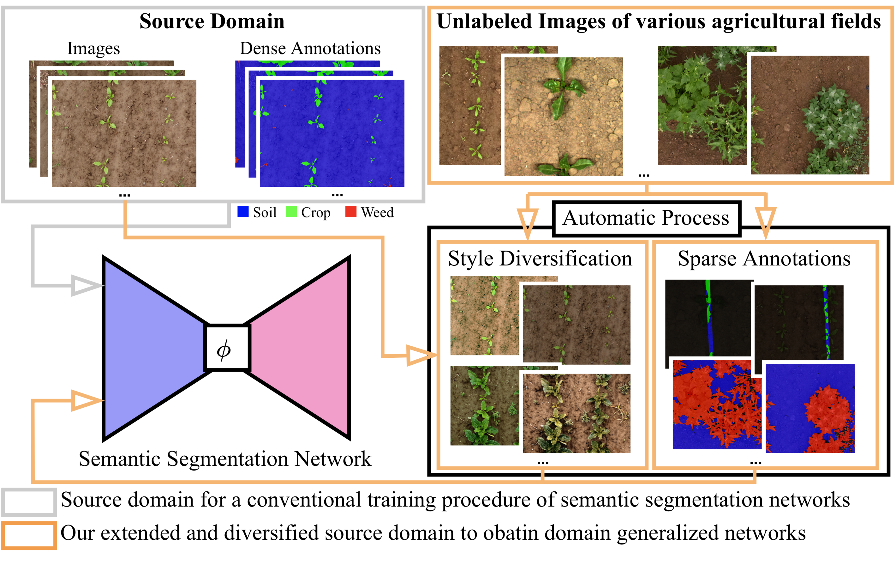

# DG-CWS
*[Towards Domain Generalization in Crop and Weed Segmentation for Precision Farming Robots](https://www.ipb.uni-bonn.de/pdfs/weyler2023ral.pdf)*

We present a novel approach to leverage unlabeled images captured from various
agricultural fields to develop domain generalized CNNs that enables agricultural
robots to perform a reliable semantic segmentation of the classes soil, crop,
and weed in different fields.



# Setup
```bash
conda create -n dgcws python=3.8
conda activate dgcws
pip install -r ./requirements.txt
pip install torch==1.10.1+cu113 torchvision==0.11.2+cu113 torchaudio==0.10.1+cu113 -f https://download.pytorch.org/whl/cu113/torch_stable.html
pip install setuptools==59.5.0
```

Please note that the cuda version depends on your local machine.

# Training

```python
python train.py --config ./configs/erfnet/config_uav_bonn.yaml --export_dir </path/to/export/directory>
```

Before you start the training you need to specify the paths to the datasets in the corresponding configuration file.

# Testing
```python
python test.py --config ./configs/erfnet/config_uav_bonn.yaml --export_dir </path/to/export/directory> --ckpt_path <path/to/erfnet.ckpt>
```

Before you start the testing you need to specify the paths to the datasets in the corresponding configuration file.

# Datasets

Please download the respective parts using the links below, and modify the directories in the configuration files accordingly. Each zip file contains a folder 'images/rgb' with the RGB images, and `annotations` with the masks used by our dataloader located in `datasets\uav_bonn.py`. 

- [UAV Bonn](https://www.ipb.uni-bonn.de/html/projects/weyler2023ral/uav-bonn.zip) (0.8 GB)
- [UAV Zurich](https://www.ipb.uni-bonn.de/html/projects/weyler2023ral/uav-zurich.zip) (0.8 GB)
- [Sparse Crops](https://www.ipb.uni-bonn.de/html/projects/weyler2023ral/sparse_crops.zip) (2.7 GB)
- [Sparse Weeds](https://www.ipb.uni-bonn.de/html/projects/weyler2023ral/sparse_weeds.zip) (0.4 GB)

(Please note: We cannot publish the UGV Stuttgart data used in the paper as our industrial partner Bosch has the intellectual property for this data.)

# Pretrained Models
- [ERFNet](https://www.ipb.uni-bonn.de/html/deeplearningmodels/weyler2023ral/erfnet/erfnet.ckpt)
- [DeepLabV3+](https://www.ipb.uni-bonn.de/html/deeplearningmodels/weyler2023ral/deeplabv3plus/deeplab.ckpt)

# License
This software is released under a creative commons license which allows for personal and research use only. For a commercial license please contact the authors. You can view a license summary [here](https://creativecommons.org/licenses/by-nc/4.0/).

# Citation

If you use the data or our code in your publications, please cite our work:

```bibtex
@article{weyler2023ral,
    author = {J. Weyler and T. L\"abe and F. Magistri and J. Behley and C. Stachniss},
    title = {{Towards Domain Generalization in Crop and Weed Segmentation for Precision Farming Robots}},
    journal = {IEEE Robotics and Automation Letters (RA-L)},
    volume = 8,
    number = 6,
    pages = {3310--3317},
    issn = {2377-3766},
    year = {2023},
    doi = {10.1109/LRA.2023.3262417},
}
```
